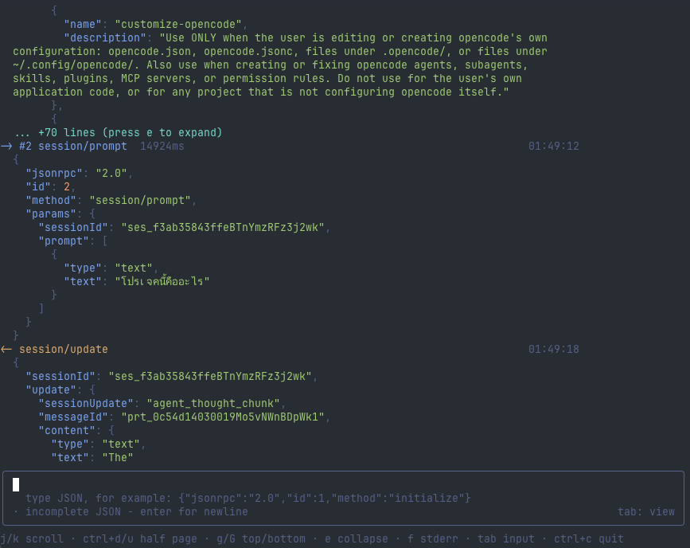

# json-rpc-debug-tui

Terminal UI debugger for newline-delimited JSON-RPC processes such as ACP agents.

`json-rpc-debug-tui` runs a child process, displays its JSON-RPC traffic in real time,
and lets you send valid JSON messages interactively without mutating them.

The TUI runs in the terminal's alternate screen, fills the viewport, adapts when the terminal is resized, and restores the previous screen when it exits. If the terminal is smaller than 40 columns by 9 rows, enlarge it to continue.

## Screenshot



## Requirements

- [Bun](https://bun.sh/) 1.2 or newer
- An interactive terminal

## Usage

```bash
bun install
bun run src/main.tsx opencode acp
bun run src/main.tsx npx -y @google/gemini-cli --experimental-acp
```

Everything after the options is passed to `Bun.spawn` as the child command. If no command is provided, `json-rpc-debug-tui` asks for one inside the TUI.

```bash
bun run src/main.tsx --cwd ~/project --env DEBUG=1 opencode acp
bun run src/main.tsx --log session.ndjson opencode acp
bun run src/main.tsx --shell 'opencode acp'
```

### Options

- `--cwd <path>`: set the child process working directory.
- `--env KEY=VALUE`: add an environment variable. Repeatable.
- `--log <file>`: append all wire messages to a file.
- `--shell`: run the command through `/bin/sh -c`.
- `-h`, `--help`: show the command help.

The same options are available when invoking the local executable as `json-rpc-debug-tui`.

## Controls

- Input mode: Enter sends valid JSON; Enter on incomplete JSON inserts a newline.
- Tab or Escape: switch to view mode.
- View mode: `j`/`k` scroll, `Ctrl+D`/`Ctrl+U` half page, `g`/`G` top/bottom, `e` expand, `f` toggle stderr.
- `Ctrl+R`: restart the child process.
- `Ctrl+S`: export the visible session log as `.ndjson`.
- `Ctrl+L`: clear the event stream.
- `Ctrl+C`: clear the input once, quit when the input is empty.

## Development

```bash
bun test
bun run typecheck
bun run src/main.tsx bun dev/mock-agent.ts
```
